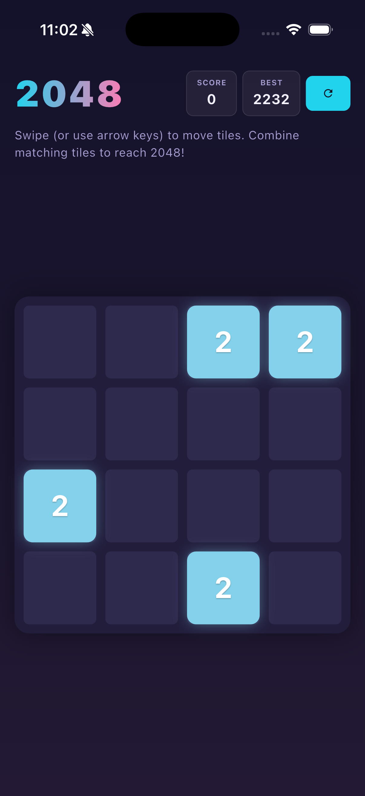

# 2048

A polished, cross-platform implementation of the classic **2048** puzzle game, built with [Flutter](https://flutter.dev). Slide numbered tiles across a 4x4 grid, combine matching values, and try to reach the 2048 tile before the board fills up.



## Features

- **Classic 2048 gameplay** — a 4x4 grid seeded with 3-4 random starting tiles (value 2 or 4).
- **Swipe or keyboard controls** — swipe in any of the four directions on touch devices, or use the arrow keys on desktop/web.
- **Smooth animations** — tiles slide to their new position and pop when they spawn or merge, powered by Flutter's implicit animation widgets.
- **Accurate merge rules** — equal tiles merge exactly once per move (a row of `2 2 2 2` becomes `4 4`, never `2 8`), and the score updates accordingly.
- **Live score tracking** — current score and best score are shown at all times; best score persists across app restarts via `shared_preferences`.
- **Game-over detection** — the game recognizes when the board is full and no legal moves remain, and shows a "Game Over" overlay.
- **One-tap restart** — reset the board and score at any time.
- **Responsive layout** — the board scales to fill the available screen space on any device size, from phones to desktop windows.
- **Custom "Aurora" visual theme** — a dark, gradient-based color identity where tile color rotates smoothly through the hue wheel as values climb, instead of the original's fixed color table.

## Screenshots

The image above was captured running natively on an iOS Simulator (iPhone 17 Pro). The app looks and behaves the same on Android, web, and desktop.

## Tech Stack

| Layer | Choice |
|---|---|
| Framework | [Flutter](https://flutter.dev) 3.44+ (Dart SDK ^3.12) |
| State management | Plain `ChangeNotifier` + `ListenableBuilder` (no external state package needed) |
| Persistence | [`shared_preferences`](https://pub.dev/packages/shared_preferences) for the best score |
| Testing | `flutter_test` (unit tests for game logic + widget smoke tests) |
| Linting | `flutter_lints` via `analysis_options.yaml` |

No backend, no network calls, and no third-party API keys are required — the entire game runs locally on-device.

## Project Structure

```
lib/
├── main.dart                    # App entry point (MaterialApp + theme setup)
├── models/
│   ├── tile.dart                 # Tile: value, grid position, animation flags
│   └── game_board.dart           # GameBoard: grid state, moves, merging, scoring,
│                                  # spawning, and game-over detection (pure logic,
│                                  # no Flutter widget dependencies)
├── services/
│   └── best_score_store.dart     # Reads/writes the persisted best score
├── theme/
│   └── app_theme.dart            # Centralized colors, gradients, and tile palette
└── widgets/
    ├── game_screen.dart          # Screen scaffold: header, gestures, keyboard input,
    │                              # game-over overlay
    ├── board_widget.dart         # Grid background + animated tile positioning
    ├── tile_widget.dart          # A single tile (color, value, pop/merge animation)
    └── score_box.dart            # Score/best-score display card

test/
├── game_board_test.dart          # Unit tests for GameBoard (moves, merges, game over)
└── widget_test.dart              # Widget smoke tests for the running app
```

The architecture keeps concerns separated on purpose:

- **`models/`** contains only plain data and game rules — it has no knowledge of Flutter widgets, which makes it fast and simple to unit test in isolation.
- **`services/`** handles side effects (persistence) so the models stay pure.
- **`widgets/`** is purely presentational and reacts to `GameBoard` via a `ChangeNotifier` listener — it never contains game logic itself.

## Getting Started

### Prerequisites

- [Flutter SDK](https://docs.flutter.dev/get-started/install) 3.44 or newer (includes Dart)
- A configured target platform toolchain for whichever platform you want to run on:
  - **iOS**: Xcode + an iOS Simulator or physical device
  - **Android**: Android Studio / Android SDK + an emulator or physical device
  - **Web**: any modern browser (Chrome recommended for `flutter run`)
  - **Desktop**: platform build tools for macOS, Windows, or Linux (enabled automatically by Flutter)

Verify your setup with:

```bash
flutter doctor
```

### Installation

```bash
git clone https://learn.reboot01.com/git/fjassim/twenty-forty-eight.git
cd twenty-forty-eight
flutter pub get
```

### Running the app

List the devices available to you:

```bash
flutter devices
```

Then run on your target of choice:

```bash
flutter run                  # runs on the first available/connected device
flutter run -d chrome        # web
flutter run -d macos         # macOS desktop
flutter run -d <device-id>   # a specific simulator, emulator, or physical device
```

### Running the tests

```bash
flutter test
```

### Static analysis

```bash
flutter analyze
```

## How to Play

1. The board starts with 3-4 tiles, each worth 2 or 4.
2. Swipe (touch) or press an arrow key (desktop/web) to slide every tile as far as possible in that direction.
3. When two tiles with the same value collide, they merge into one tile of double the value, and your score increases by that amount.
4. After every move, a new tile (2 or 4) appears in a random empty cell.
5. The game ends when the board is full and no two adjacent tiles share the same value — no more legal moves remain.
6. Tap the restart button at any time to start a new game. Your best score is preserved across restarts and app relaunches.

## Roadmap / Possible Enhancements

These are not implemented yet but would be natural next steps:

- Configurable grid size (5x5, 6x6, ...) and starting tile values
- Sound effects / background music
- Difficulty levels

## License

No license has been specified for this project yet.
